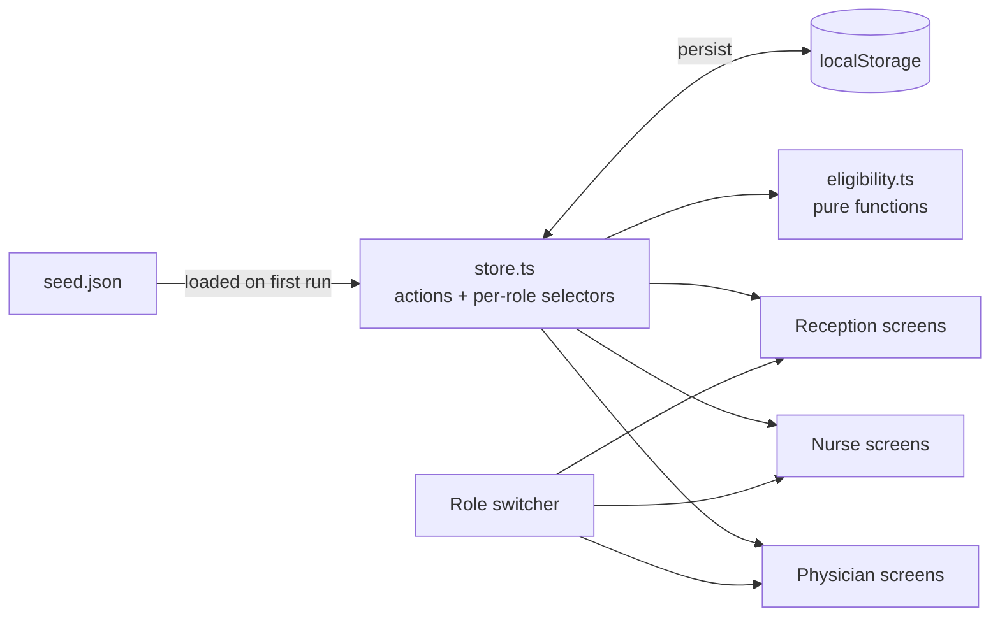
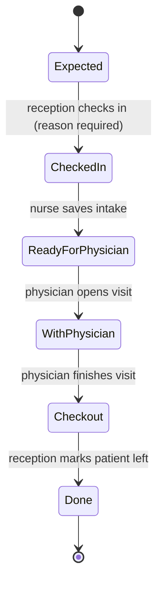
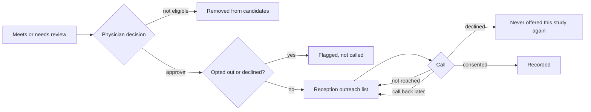

# Technical Documentation

How the Kubcio clinic prototype is put together, why it is built this way, and how it is tested.

**Live:** https://kubcio-clinic-management-prototype.vercel.app/

> File paths below follow the planned layout. If the implementation differs, the code is the source of truth.

---

## 1. Architecture at a glance

A static single-page React app. There is no backend: a seed JSON file is the starting state, every change is saved to the browser's localStorage, and Reset demo restores the seed.



Three rules hold the design together:

1. **Screens never touch storage.** All reads and writes go through `store.ts`.
2. **Role visibility is enforced in the data layer.** Reception selectors return objects that simply do not contain clinical fields.
3. **Eligibility is computed, never stored.** It always reflects the latest notes, diagnoses and results.

## 2. Tech stack

| Layer | Choice | Why |
| --- | --- | --- |
| Build | Vite + React + TypeScript | Fast setup; types catch AI-generated mistakes early |
| Styling | Tailwind CSS v4 (`@tailwindcss/vite`) | Consistent UI without a design system |
| Data | `src/data/seed.json` + localStorage | Works on any static host; each reviewer gets a private, clean demo |
| Tests | Vitest + React Testing Library + jsdom | Fast; matcher tests mirror the spec's test table |
| Hosting | GitHub + Vercel | Push to deploy; public link for reviewers |

**Why no AI at runtime:** a static page cannot hide an API key, and a clinic needs to see *why* a patient matched. Rules with quoted evidence are deterministic and testable. AI was used to build the app, not to make eligibility calls.

## 3. Folder layout

```
src/
  data/seed.json              synthetic patients, visits, notes, results, study
  domain/types.ts             entity types
  domain/eligibility.ts       study matcher (pure functions)
  domain/eligibility.test.ts  M-01 to M-20
  store/store.ts              load seed, persist, actions, role selectors
  store/*.test.ts             seed-vs-matcher, visibility, task timing
  screens/Reception.tsx
  screens/Nurse.tsx
  screens/Physician.tsx       visit view, results inbox, study panel
  screens/Outreach.tsx
  components/RoleSwitcher.tsx
  components/DemoControls.tsx simulate result, reset demo
docs/kubcio-spec.md           source spec
specs/                        Spec Kit artifacts
```

## 4. Data model

| Entity | Key fields | Notes |
| --- | --- | --- |
| Patient | id, name, dateOfBirth, phone, studyCallOptOut | Opt-out blocks all study outreach |
| Visit | id, patientId, date, time, bookedReason, confirmedReason, walkIn, status | See visit lifecycle below |
| Observation | visitId, bpSystolic, bpDiastolic, weightKg, tempC, patientReport, recordedAt | Entered by the nurse |
| Note | id, patientId, visitId, date, authorRole, text | Free text, read by the matcher |
| Diagnosis | id, patientId, label, status, recordedOn | Formal diagnosis list; active or resolved |
| Order | id, patientId, visitId, test, reasonOrdered, status, value, resultedAt, reviewedAt, reviewNote | pending → resulted → reviewed |
| Task | id, patientId, visitId, assignee, action, dueType, dueDate, waitsOnOrderId, offsetDays, status | waiting → open → done |
| Study | id, name, criteria[] | Criteria are data |
| StudyDecision | patientId, studyId, decision, decidedBy, decidedAt | Approve contact or not eligible |
| Outreach | patientId, studyId, attempts[] (at, reached), outcome | none, declined or consented |

Units are metric: kg, °C, mmHg.

### Visit lifecycle



### Task timing

| Timing chosen by physician | Saved as | Due date |
| --- | --- | --- |
| A specific date | open | That date |
| In N days | open | Today + N |
| N days after result of an order | waiting | Set when the order is reviewed: review date + N |

When an order is reviewed, every task waiting on it becomes open and appears on reception's task list, without any result details.

## 5. Role visibility

| Information | Receptionist | Nurse | Physician |
| --- | --- | --- | --- |
| Schedule, check-in status, contact, reason | Yes | Yes | Yes |
| Nurse observations | No | Yes | Yes |
| History, notes, diagnoses | No | Read only | Yes |
| Physician assessment | No | No | Yes |
| Results awaiting review | No | No | Yes |
| Tasks assigned to reception | Yes | No | Yes |
| Study eligibility and evidence | No | No | Yes |
| Outreach calls (study name, outcome) | Yes | No | Yes |
| Study opt-out and per-study decline | Yes | No | Yes |

Enforced by per-role selectors in `store.ts`. A test asserts reception selectors return no observation, note, diagnosis, result or eligibility fields. The role switcher is a prototype stand-in, not access control.

## 6. Study eligibility engine

`eligibility.ts` returns one of **meets**, **doesn't meet** or **needs review** per study, with evidence or a reason for every criterion. When the rules can't be sure, the answer is needs review, because the clinic owner reads unclear notes personally.

**Combining criteria:** any criterion that doesn't meet → doesn't meet. Otherwise any needs review → needs review. Otherwise meets.

### Age (min 18)

| Data | Result |
| --- | --- |
| 18 or over on "today" | Meets |
| Under 18 | Doesn't meet |
| Date of birth missing | Needs review |

"Today" is passed in as a parameter so tests are stable.

### Documented diabetes, checked in order

| # | Finding | Result |
| --- | --- | --- |
| 1 | Active diabetes entry on the diagnosis list | Meets |
| 2 | A note sentence clearly stating the patient has diabetes | Meets |
| 3 | A positive finding plus a sentence denying diabetes | Needs review (conflicting chart) |
| 4 | Only gestational diabetes | Needs review (study criteria silent) |
| 5 | Only uncertain wording ("?diabetes", "possible", "suspected") | Needs review |
| 6 | Only indirect evidence (a diabetes medication, no statement) | Needs review |
| 7 | Glucose or HbA1c order pending, or resulted but not yet reviewed | Needs review |
| 8 | Only prediabetes, family history or a denial | Doesn't meet |
| 9 | No mention | Doesn't meet ("no evidence found") |

**Sentence handling:** notes are split into sentences. A sentence that mentions diabetes is checked for family words (mother, father, sibling, family history), prediabetes words (prediabetes, borderline, impaired fasting glucose) and negation (no, denies, not, ruled out). Only what remains can count as a positive statement.

**When it runs:** on demand whenever a patient's study status is shown, so it updates after a note is saved or a result is reviewed.

**What it ignores:** opt-out and per-study decline affect outreach only, never the eligibility outcome.

## 7. Study outreach flow



Reception's outreach list shows name, phone, study name and attempts only.

## 8. Testing

| Suite | Covers | Spec IDs |
| --- | --- | --- |
| `eligibility.test.ts` | All matcher rules and edge cases | M-01 to M-20 |
| Seed vs matcher | Every seeded edge-case patient gets its expected outcome | M-01 to M-20 |
| Visibility | Reception selectors contain no clinical fields | S-05 |
| Task timing | Due dates for "in N days" and "after result" | S-06, AC-18 |
| Outreach | Decline and opt-out behaviour | S-11, S-12 |
| Components | Check-in blocked without reason; vitals validation | S-02, S-04 |

Other scenarios (S-01, S-03, S-07 to S-10, S-13, S-14) are checked by hand using the walkthrough in [GUIDED_TOUR.md](./GUIDED_TOUR.md).

```bash
npm test
```

## 9. Build and deploy

- `npm run build` outputs a static site to `dist/`.
- Hosted on Vercel, connected to the GitHub repo. Every push to `main` redeploys.
- Seed data is bundled with `import`, not fetched at runtime, so it works on any static host.

## 10. Extending it

**Add a study:** add an entry to `studies` in `seed.json` with its criteria. Supported criterion types are minimum age and diagnosis. A new criterion type needs a new rule function in `eligibility.ts` and tests.

**Add a backend:** replace the storage functions inside `store.ts` with API calls. Screens and selectors stay unchanged.

**Real access control:** move the per-role selectors to the server and add authentication; the selector boundary is already where it belongs.

## 11. Limitations

- No authentication, audit trail or encryption. Not for real patient data.
- Data lives in one browser; nothing is shared between users or devices.
- The matcher uses word rules, so unusual phrasing can land in needs review. That is the intended safe default.
- One study, from the clinic owner's example; no real protocol criteria.
